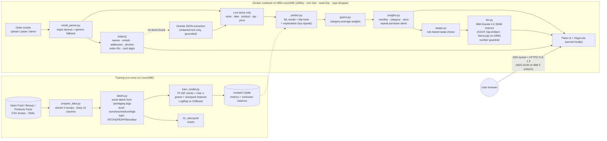

# ♻️ PlastiTrack

**Privacy-first AI that estimates the plastic packaging hiding in your online orders and nudges you toward
lower-plastic swaps, running entirely on IBM LinuxONE (s390x).**

*IBM Z Datathon 2026 · Theme: Wildcard (Sustainability) · AI Secured*

- 📧 Reads order-confirmation emails → extracts line items → **strips personal details first**
- 🧠 **Predictive ML** (scikit-learn, trained on LinuxONE on 200k Open Food/Beauty/Products Facts items)
  predicts each item's *plastic level* and *main plastic type*, then converts it to grams.
  Every prediction is **explained** ("model signals: 'whole milk', 'gal'")
- ✨ **Generative AI**: IBM **Granite 4.0 350M instruct**, converted to big-endian and run by **llama.cpp on LinuxONE**:
  writes personalized swap tips (with a no-invented-numbers guardrail) and **reads free-text emails** that the
  rule-based parser can't handle (JSON extraction, grounded against the email text)
- 📊 Dashboard: monthly plastic, breakdown by category / store / plastic type, top offenders, repeat-purchase alerts,
  and a **what-if impact panel** (yearly kg, bottles, CO₂e, ×10,000 households)
- 🔐 **HTTPS (TLS 1.3, AES-256-GCM) accelerated by the IBM Z CPACF crypto unit**: 108× faster AES-GCM than software
- 🔒 No shopping data ever goes to a third-party AI API. Even the chart library is served locally.

---

## Architecture



**Why weak labels?** Open Food Facts rarely records packaging *weights*, but often records packaging *materials
and shapes*. We turn those into labels we can defend (`src/plastitrack/labels.py`), train the model to predict
them **from the product title only** (that's all an order email contains, and packaging fields are never used
as features, so there is no label leakage), then convert to grams with transparent category averages
(`src/plastitrack/grams.py`).

---

## Results (trained on LinuxONE)

See `reports/metrics.json` and `reports/figures/`. Held-out test set = 20% (40,000 products).

| Target | Model | Accuracy | Macro-F1 |
|---|---|---|---|
| plastic_level (4 classes) | **TF-IDF + Logistic Regression** | **0.614** | **0.525** |
| plastic_level | TF-IDF (χ² top-3k) + XGBoost | 0.545 | 0.465 |
| plastic_type (6 classes) | **TF-IDF + Logistic Regression** | **0.567** | **0.497** |
| plastic_type | TF-IDF (χ² top-3k) + XGBoost | 0.445 | 0.393 |

Random guessing would score 0.25 (level) and 0.17 (type). Training took about 6–7 minutes per target on 3 LinuxONE vCPUs.
The most common type confusion is HDPE ↔ PET (both are bottles).

### Inference performance on LinuxONE (3 vCPU) — `python scripts/benchmark.py`

| Task | Result |
|---|---|
| Email parsing + PII redaction | 2,673 emails/s |
| ML scoring (1 core / 3 cores in parallel) | 3,083 / **7,239 items/s** |
| Single-item latency | p50 2.2 ms, p95 2.5 ms |
| Granite swap tip (350M instruct, Q8_0) | ~7 s |
| Granite JSON extraction of a free-text email | ~17 s |

### IBM Z CPACF crypto — `bash scripts/crypto_benchmark.sh` (OpenSSL 3.0, 16 KB blocks)

| Algorithm | CPACF on | CPACF off (software) | Speed-up |
|---|---|---|---|
| AES-256-GCM (TLS 1.3 cipher used by the app) | 15,062 MB/s | 140 MB/s | **108×** |
| AES-128-GCM | 15,176 MB/s | 168 MB/s | 90× |
| SHA-256 | 4,404 MB/s | 276 MB/s | 16× |
| SHA-512 | 6,779 MB/s | 441 MB/s | 15× |

The labels are inherently noisy (the same product is sold in different packs), so these are honest numbers.
For the demo, explicit packaging words in a title ("Glass Jar", "Cans", "Clamshell", "Shampoo Bar") override
the model, and the UI shows the `source` of every prediction.

---

## Repository layout

```
src/plastitrack/
  labels.py         weak labels from packaging tags/text
  categories.py     product -> category group (keyword rules)
  features.py       TF-IDF + size/pack-count features (shared by training and inference)
  email_parser.py   email -> line items, and personal-detail redaction
  predict.py        loads models, hybrid ML + title hints, per-item explanations
  grams.py          level -> estimated grams of plastic
  swaps.py          swap suggestions + template tips
  llm.py            IBM Granite via llama.cpp (local): swap tips + JSON email extraction, with guardrails
  insights.py       pipeline + aggregates + repeat-purchase alerts
  viz.py            shared chart colors (color-blind-safe palette)
scripts/
  prepare_data.py   build labeled dataset from the dumps
  train_model.py    train + evaluate + save models
  make_eda_notebook.py / make_demo_emails.py
  run_pipeline.py   command-line end-to-end demo
  container.sh      build / run / status of the hardened container (run on LinuxONE)
  get_llm.sh        download Granite instruct GGUFs + convert to big-endian
  make_cert.sh      self-signed TLS cert for HTTPS
  crypto_benchmark.sh  CPACF on/off OpenSSL benchmark
  benchmark.py      inference throughput / latency
  sync_to_linuxone.sh / run_remote.sh   laptop -> LinuxONE helpers
app/                Flask web UI (web.py, templates/, static/ incl. vendored Vega JS)
notebooks/01_eda.ipynb
demo_emails/        20 synthetic order emails (fictional stores, fake personal data)
  extra/            a free-text email the rules can't parse (Granite extracts it)
reports/            metrics.json, figures/ (EDA + confusion matrices), logs
Dockerfile, requirements*.txt
```

---

## Setup and run on IBM LinuxONE

Tested on LinuxONE Community Cloud: Ubuntu 24.04, s390x, 3 vCPU, 8 GB RAM, Docker 29.
The LinuxONE lab image (`registry.linuxone.cloud.marist.edu/l1cc/jupyterlab-image-s390x`) provides s390x
builds of Python 3.12, scikit-learn, XGBoost, llama-cpp-python and the big-endian Granite GGUF.

```bash
# 0) get the code onto LinuxONE (from the laptop; or git clone on LinuxONE)
LINUXONE_KEY=~/key.pem ./scripts/sync_to_linuxone.sh

# on LinuxONE, inside the lab container (or: ./scripts/run_remote.sh <cmd> from the laptop)
cd ~/shared/plastitrack
pip install --only-binary=:all: -r requirements-app.txt

# 1) data (~1.3 GB download, ~90 s to process on LinuxONE)
cd data/raw
curl -sLO https://static.openfoodfacts.org/data/en.openfoodfacts.org.products.csv.gz      && mv en.openfoodfacts.org.products.csv.gz off_products.csv.gz
curl -sLO https://static.openbeautyfacts.org/data/en.openbeautyfacts.org.products.csv.gz  && mv en.openbeautyfacts.org.products.csv.gz obf_products.csv.gz
curl -sLO https://static.openproductsfacts.org/data/en.openproductsfacts.org.products.csv.gz && mv en.openproductsfacts.org.products.csv.gz opf_products.csv.gz
cd ../..
python scripts/prepare_data.py --sample 200000

# 2) EDA notebook
python scripts/make_eda_notebook.py
jupyter nbconvert --to notebook --execute --inplace notebooks/01_eda.ipynb

# 3) train (~25 min on 3 vCPU)
python scripts/train_model.py

# 3b) Granite instruct LLM (downloads ~1.9 GB, converts to big-endian)
bash scripts/get_llm.sh

# 4) command-line demo (add --llm for Granite tips)
python scripts/make_demo_emails.py
python scripts/run_pipeline.py --llm

# 5) web app, dev mode
python app/web.py            # http://127.0.0.1:8501

# 6) benchmarks
python scripts/benchmark.py
bash scripts/crypto_benchmark.sh     # run on the LinuxONE host (uses its OpenSSL)
```

### Container (on the LinuxONE host)

```bash
cd ~/shared/plastitrack
bash scripts/make_cert.sh         # optional: enables HTTPS (TLS 1.3, CPACF-accelerated)
./scripts/container.sh build      # docker build -t plastitrack:1.0 .
./scripts/container.sh run        # hardened: 127.0.0.1 only, non-root, read-only FS, cap-drop ALL,
                                  # no-new-privileges, 3 GB / 2 CPU / 256 PID limits
./scripts/container.sh status     # health, arch (s390x / big-endian), security settings, resource usage
```

Open the app from your laptop through an SSH tunnel (the port is never exposed publicly):

```bash
ssh -i key.pem -L 8501:localhost:8501 linux1@<linuxone-ip>
# browse to https://localhost:8501 (accept the self-signed cert once)
#   /demo loads the demo emails; /demo?tab=t2 opens Alerts, ?tab=t3 Line items, ?tab=t4 Privacy
```

---

## Privacy and security design

| What | How |
|---|---|
| No third-party AI | ML model and Granite LLM both run on the LinuxONE CPU; no API keys exist in the code |
| Data minimization | Only line items (store, date, product, qty, price) are kept; raw emails are discarded after parsing |
| PII redaction | Names, emails, street addresses, city/ZIP, phone numbers, order IDs, card digits are replaced with tags; the UI shows the redacted text so users can verify |
| No disk writes | Session data lives in server memory only; "Clear my data" deletes it |
| No CDNs | Vega/Vega-Lite JS is served from the container, so the browser makes no third-party calls |
| Encryption in transit | HTTPS with TLS 1.3 / AES-256-GCM (ECDSA P-256 cert), executed by the IBM Z **CPACF** unit, inside an SSH tunnel |
| Network | App bound to `127.0.0.1`; never exposed on a public port |
| LLM guardrails | Tips containing any number not in the input are rejected; extracted items must appear in the email (words + price) |
| Explainability | Every prediction shows its source and top model signals |
| Container hardening | Non-root user, read-only root filesystem, all Linux capabilities dropped, `no-new-privileges`, resource limits, health check |

**IBM Z platform notes.** `/proc/cpuinfo` on our instance lists `nnpa` (the Telum on-chip AI accelerator), `msa`
(CPACF crypto) and `vx` (vector). The lab's llama.cpp build includes IBM's **zDNN / NNPA backend**. For our small
350M f16 model we measured no speed-up from NNPA offload (16.1 s vs 15.5 s for one tip), so the app runs the
LLM on the CPU threads. GGUF files are little-endian, so we byte-swap IBM's published instruct models with
llama.cpp's `gguf_convert_endian` (`scripts/get_llm.sh`); the Q8_0 350M instruct model is ~2× faster than the lab's
f16 base model and follows instructions.

**Known limitations.** Labels are weak (rule-derived); grams are category-average estimates; the redactor catches
names from greetings and the `To:` header but can miss other people named in free text (e.g. a driver's first name);
the model has little non-food training data, so electronics use a labeled category default.

---

## Open-source libraries and data

| Component | Link | License |
|---|---|---|
| Open Food Facts data | https://world.openfoodfacts.org/data | ODbL 1.0 (database), DbCL (contents) |
| Open Beauty Facts data | https://world.openbeautyfacts.org/data | ODbL 1.0 |
| Open Products Facts data | https://world.openproductsfacts.org/data | ODbL 1.0 |
| IBM Granite 4.0 (350M) | https://huggingface.co/ibm-granite | Apache 2.0 |
| llama.cpp / llama-cpp-python | https://github.com/ggml-org/llama.cpp · https://github.com/abetlen/llama-cpp-python | MIT |
| scikit-learn | https://scikit-learn.org | BSD-3 |
| XGBoost | https://xgboost.ai | Apache 2.0 |
| pandas / NumPy / SciPy | https://pandas.pydata.org · https://numpy.org · https://scipy.org | BSD-3 |
| matplotlib | https://matplotlib.org | PSF-based |
| joblib | https://joblib.readthedocs.io | BSD-3 |
| Flask | https://flask.palletsprojects.com | BSD-3 |
| gunicorn | https://gunicorn.org | MIT |
| Altair | https://altair-viz.github.io | BSD-3 |
| Vega / Vega-Lite / vega-embed | https://vega.github.io | BSD-3 |
| Jupyter | https://jupyter.org | BSD-3 |

Data attribution: *Contains information from Open Food Facts, Open Beauty Facts and Open Products Facts,
which are made available under the Open Database License (ODbL).*

Demo emails are synthetic: the stores (RiverMart Online, SuperValu Mart, Northstar Goods) and the customer are
fictional, and all contact details use `example.com` / `555` numbers.
